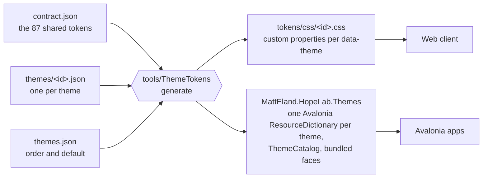
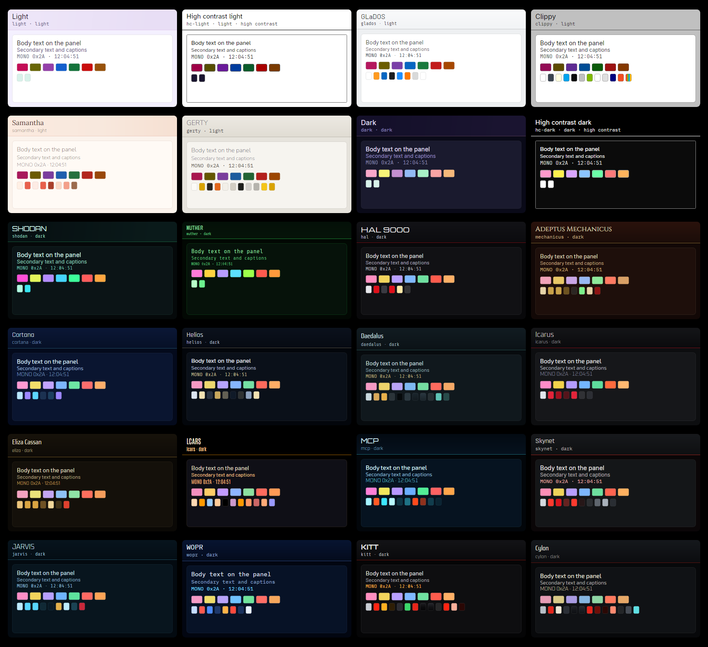

# Theme tokens

The colours, faces and sizes of every HopeLab theme live here once, as plain JSON, and each app gets them in its own
format from a generator. A theme is designed once and looks the same in the web client and the desktop apps.





## What's here

| File | What it holds |
|---|---|
| `contract.json` | Every token a theme can set: its neutral name, its CSS custom property, its kind, whether every theme must set it, its default, and what it's for |
| `themes.json` | The catalogue order, and the theme apps start on (`default`, also written onto `:root` in CSS) |
| `themes/<id>.json` | One theme: name, description, scheme, high contrast, icon, motto, its token values, and its own `chrome` colours |
| `css/` | **Generated.** `base.css` (faces, type scale, spacing), one `<id>.css` per theme, and `index.css` importing them all |

## Values

Values are written as CSS writes them: `#RRGGBB`, `rgba()`, `linear-gradient()`, a box shadow, a font stack, a number.
A value can point at another token as `{surface.panel}`, or at one of the theme's own chrome colours as
`{chrome.amber}`; CSS gets `var(--surface-panel)`, Avalonia gets the resolved value.

Every theme must set the 50 required tokens (surfaces, accents, ink, text, borders, gradients, glows, chart colours,
and the assistant's face colours). The rest (faces, the assistant's line style, type scale, spacing) fall back to the
contract's default.

## Names

The names are neutral, so any app can use them; the CSS keeps the web client's existing property names, so its CSS
didn't change. In Avalonia every key is `Lab.` plus the name in Pascal case: `accent.primary` is the brush
`Lab.Accent.Primary` and the colour `Lab.Accent.Primary.Color`.

| Token | CSS | What it means |
|---|---|---|
| `surface.canvas` | `--surface-void` | The canvas behind everything |
| `accent.primary` | `--accent-pink` | Primary actions, the active item (CORA: STORE) |
| `accent.highlight` | `--accent-yellow` | New things (CORA: CREATE) |
| `accent.link` | `--accent-purple` | Links, relationships (CORA: MERGE) |
| `accent.info` | `--accent-blue` | Information, lookups (CORA: RETRIEVE) |
| `accent.warning` | `--accent-orange` | Unknown states, warnings |
| `text.primary`, `text.secondary`, `text.mono` | `--text-primary-dark`, `--text-secondary-dark`, `--text-machine` | Body, secondary and monospaced text |
| `ink.icon`, `ink.overlay` | `--icon-ink`, `--overlay-ink` | An icon on an accent fill; the ink of translucent overlays |
| `persona.*` | `--surface-chrome`, `--surface-mane`, `--her-*`, … | How the assistant's face is drawn |
| `gradient.assistant-bubble` | `--gradient-cora-bubble` | A chat message from the assistant |
| `font.mono`, `font.body` | `--font-machine`, `--font-persona` | Monospaced and body faces |

The rest keep their CSS names (`surface.panel` is `--surface-panel`). `contract.json` has all 87.

## Using the themes in an Avalonia app

Reference `MattEland.HopeLab.Themes`, then swap the theme's dictionary into the application's resources and bind with
`DynamicResource`, so a switch repaints everything:

```csharp
var resources = ThemeCatalog.FindOrDefault(savedThemeId).CreateResources();   // compiled; trim- and AOT-safe
Application.Current!.Resources.MergedDictionaries[0] = resources;
```

```xml
<Border Background="{DynamicResource Lab.Surface.Panel}" CornerRadius="{DynamicResource Lab.Radius}">
  <TextBlock Foreground="{DynamicResource Lab.Text.Primary}" FontFamily="{DynamicResource Lab.Font.Body}" />
</Border>
```

## What's shared and what each app keeps

Shared, in the token files: every colour, gradient and glow, the faces, the type scale and spacing, the chart colours,
the assistant's face, each theme's own chrome colours (KITT's scanner, LCARS's bars), names, descriptions, icons and
mottos.

Each app keeps:
- **Chrome and effects**: the controls and stylesheets that draw a theme's scanner, bezels or CRT lines. They read the
  shared `Lab.Chrome.*` / `--<theme>-*` colours but stay in the app, because they're drawn differently on each.
- **Wording**: what a theme says in an app's own screens (a composer placeholder, a subtitle).
- **App-only keys**: anything only one app draws (an embedded terminal's colours, a caps font alias). An app adds
  these in its own dictionary on top of the shared one.
- **Which themes it offers, and its own themes**: an app lists `ThemeCatalog.All` and adds its own beside them.

## Rules the tests hold every theme to

- Every required token set, nothing outside the contract, every reference resolves.
- Text, and the accents (used as text and icons), reach 4.5:1 on the canvas, panel, elevated and header surfaces; 7:1
  in a high-contrast theme.
- `ink.icon` reaches 4.5:1 on every accent.
- The four chart series reach 3:1 on the panel (WCAG 1.4.11; a series is a non-text mark).
- The seven accents stay at least ΔE 12 apart, because each one means something.
- The generated files in the repository match the token files.

The light themes Light, GLaDOS, Clippy, Samantha and GERTY share CORA's projector-safe series (CORA T-115), which
clear 3:1 on each of their panels with room to spare and pass the colour-blind separation checks. Because every series token
passes, CSS and Avalonia draw the same colour; the Avalonia generator's lift for a short series no longer fires.

## Commands

```bash
dotnet run --project tools/ThemeTokens -- generate          # write tokens/css/ and the Avalonia themes
dotnet run --project tools/ThemeTokens -- generate --check  # fail if they're out of date (the tests check this too)
```

The themes were seeded from the web client's CSS. Until it reads these files, its CSS can be compared, value by
value, with what the generator writes (`import` takes the same options and rewrites `themes/` from that CSS):

```bash
web=<web client checkout>/apps/cora-client/src
dotnet run --project tools/ThemeTokens -- compare --colors $web/tokens/colors.css --themes $web/tokens/themes \
  --typography $web/tokens/typography.css --spacing $web/tokens/spacing.css
```

## Known gaps in Avalonia

- `glow.node-active` is `currentColor`, the colour of whatever it's on, which a resource can't be; apps draw that glow
  themselves.
- Cylon's `ribs` chrome is a `repeating-linear-gradient()`, which Avalonia has no brush for.
- Three variable faces (Oxanium, Nunito, Quicksand) load at their default instance, which is a light weight, so
  Samantha's and GERTY's text draws thin; the same is true in OneRing today.
